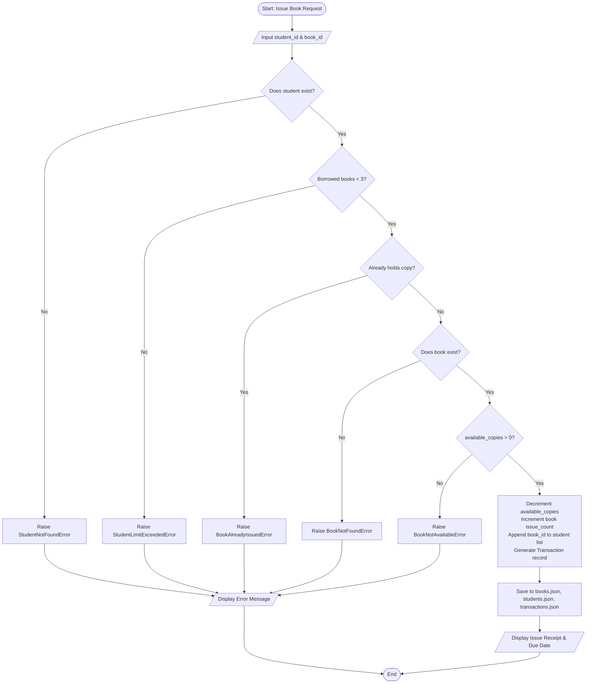
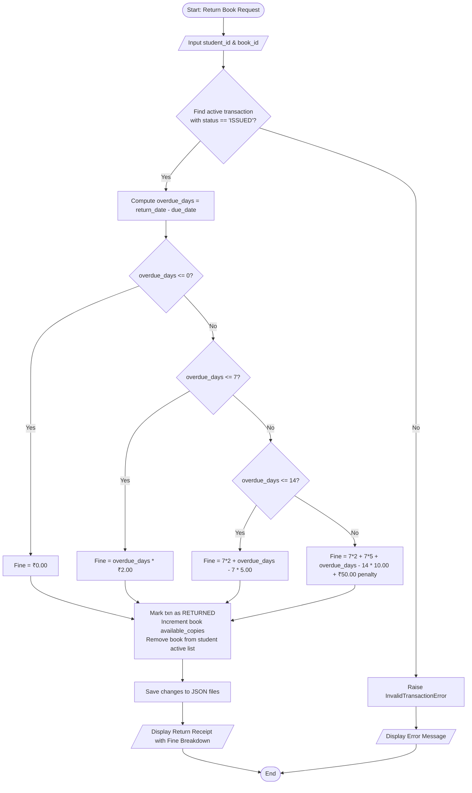

# Library Management System (LMS)
**Course:** MCA17400 — Problem Solving Using Python  
**Project-Based Learning (PBL) Report & Technical Documentation**  
**Development Tool:** Visual Studio Code (VS Code) | **Language:** Python 3.x  

---

## 🌐 Web Application Edition (Modern Full-Stack Upgrade)

The Library Management System is equipped with **both** the original CLI console application **and** a **modern, full-stack Web Application** running locally:

- **Frontend URL:** [http://localhost:5173](http://localhost:5173)
- **Backend API Server:** [http://localhost:5000/api](http://localhost:5000/api)
- **One-Click Launch:** Simply run `run_web.bat` in the project root.

### Web Architecture & Technology Stack:
1. **Backend API:** Node.js + Express with built-in `node:sqlite` database (zero external native C++ dependencies).
2. **Database:** SQLite (`backend/database/library.db`), initialized and synchronized with original JSON seed datasets.
3. **Frontend Application:** React 19 + Vite 8.
4. **Design System:** Custom Vanilla CSS design system featuring dark mode, glassmorphism, responsive data grids, animated badges, and responsive stat cards.
5. **Business Logic Integrity:** 100% of domain business logic, validations (borrow limits, stock checks, duplicate checks), tiered overdue fine calculations, and custom Bubble Sort algorithms have been faithfully preserved and tested.

### Feature Mapping: Console to Web Application

| Console Menu Feature | Web Application Equivalent | Page / Component |
| :--- | :--- | :--- |
| **[1.1] Add Book** | Interactive Modal Form with live validation & instant refresh | `/books` (`Books.jsx`) |
| **[1.2] Display Available Books** | "Available on Shelf Only" toggle filter & stock progress bars | `/books` (`Books.jsx`) |
| **[1.3] Display Complete Catalog** | Responsive books table with search & sort controls | `/books` (`Books.jsx`) |
| **[1.4] Search Books** | Real-time multi-field search (All, Title, Author, Genre) | `/books` (`Books.jsx`) |
| **[1.5] Sort Books** | Criteria sorting (Title, Author, Popularity, Stock) with **Custom Bubble Sort toggle** | `/books` (`Books.jsx`) |
| **[2.1] Register Student** | Modal registration form with duplicate ID prevention | `/members` (`Members.jsx`) |
| **[2.2] Display All Students** | Members table displaying active loan quotas (X/3) & holding IDs | `/members` (`Members.jsx`) |
| **[2.3] Search Students** | Live filter by name, student ID, or department | `/members` (`Members.jsx`) |
| **[2.4] Student Loan History** | Detailed borrowing history modal listing all past & active loans | `/members` (`Members.jsx`) |
| **[3.1] Issue Book** | Issue Desk with quota validation (max 3), stock check, and **Official Issue Receipt** | `/issue` (`IssueBook.jsx`) |
| **[3.2] Return Book & Fines** | Return Desk with **Live Tiered Fine Calculator Preview** and **Official Return Receipt** | `/return` (`ReturnBook.jsx`) |
| **[3.3] Active Loans** | Real-time active loans table with dynamic OVERDUE alerts and 1-click return | `/transactions` & `/return` |
| **[3.4] Transaction Records** | Complete ledger with tab filters (All, Active, Overdue, Returned) | `/transactions` (`Transactions.jsx`) |
| **[4.1] System Summary (NumPy)** | Central tendency cards: Total titles, stock, shelf available, mean & median issues | `/analytics` & `/dashboard` |
| **[4.2] Top 5 Books (Pandas)** | Ranked popularity leaderboard with dynamic CSS progress bars | `/analytics` & `/dashboard` |
| **[4.3] Distributions (Pandas)** | Category/Genre and Student Department interactive bar distribution charts | `/analytics` & `/dashboard` |
| **[5] System Diagnostics** | Automated Test Suite running all 14 valid & invalid test assertions | `/diagnostics` (`Diagnostics.jsx`) |
| **[6] Reset / Re-seed Data** | Instant 1-click database reset and seed catalog restoration | `/diagnostics` (`Diagnostics.jsx`) |

---

## Table of Contents
1. [Web Application Edition](#-web-application-edition-modern-full-stack-upgrade)
2. [Problem Statement](#1-problem-statement)
2. [Objectives](#2-objectives)
3. [Syllabus Concepts Mapping](#3-syllabus-concepts-mapping)
4. [System Architecture & Class Design](#4-system-architecture--class-design)
5. [Algorithms & Flowcharts](#5-algorithms--flowcharts)
6. [Pseudocode](#6-pseudocode)
7. [Implementation Details](#7-implementation-details)
8. [File Structure & Data Storage](#8-file-structure--data-storage)
9. [Data Analytics & Visual Dashboard (NumPy, Pandas, Matplotlib)](#9-data-analytics--visual-dashboard)
10. [Testing & Validation (Valid & Invalid Inputs)](#10-testing--validation)
11. [How to Run in VS Code](#11-how-to-run-in-vs-code)
12. [Viva Voce & Individual Presentation Guide](#12-viva-voce--individual-presentation-guide)
13. [Individual Contribution Statement](#13-individual-contribution-statement)
14. [Conclusion & Future Scope](#14-conclusion--future-scope)

---

## 1. Problem Statement

Academic libraries in higher education institutions (such as Master of Computer Applications departments) manage hundreds of textbook titles, research literature, and enrolled student members. Manual register-based recordkeeping suffers from:
- Inefficient search and retrieval of textbooks across multiple authors and genres.
- Inaccurate tracking of issued books, available shelf stock, and student borrowing quotas.
- Arbitrary or error-prone overdue fine calculations when books are returned past due dates.
- Lack of statistical visibility into collection usage (e.g., most popular titles, borrowing duration averages, department-wise book circulation).

The goal of this project is to develop a robust, modular, and syllabus-oriented **Library Management System** using pure Python and standard analytical libraries (`NumPy`, `Pandas`, `Matplotlib`). The system maintains persistent records of books, students, and circulation transactions, enforces strict academic lending rules, calculates tiered overdue fines, and generates visual analytics for library administration.

---

## 2. Objectives

The primary objectives of this software project are:
1. **Catalog Management:** Add new books, maintain multi-copy inventories, track available vs. issued copies, and display real-time shelf status.
2. **Flexible Search & Sorting:** Enable rapid catalog searching by title, author, genre, or book ID, and provide catalog sorting via both custom algorithms (Bubble Sort) and Python's built-in sorting.
3. **Student / Member Management:** Maintain student profile records (Roll Number, Name, Department, Contact) and enforce a maximum borrowing quota (maximum 3 books simultaneously).
4. **Circulation & Overdue Fine Automation:** Automate book issue and return workflows with condition-based overdue fine assessments:
   - **0 to 7 days overdue:** ₹2.00 per day
   - **8 to 14 days overdue:** ₹5.00 per day (for days 8–14) + ₹14.00 (days 1–7)
   - **> 14 days overdue:** ₹10.00 per day + ₹50.00 flat penalty
5. **Data Persistence:** Store books, members, and transactions securely in JSON files with error-tolerant reading and writing.
6. **Data Science Integration:** Utilize **NumPy** for numerical metrics, **Pandas** for structured reporting, and **Matplotlib** for high-resolution visual charts.
7. **Robust Exception Handling:** Prevent application crashes by implementing domain-specific custom exceptions for missing records, duplicate IDs, out-of-stock items, and unauthorized operations.

---

## 3. Syllabus Concepts Mapping

This project strictly adheres to the **MCA17400: Problem Solving Using Python** curriculum without utilizing unnecessary or complex external frameworks:

| Syllabus Concept | Project Implementation | File / Location |
| :--- | :--- | :--- |
| **Conditions (`if-elif-else`)** | Overdue fine tier calculation, book availability verification, student loan limit checks, search filters, and CLI menu routing. | `models.py` (L135-155), `library_system.py` |
| **Loops (`for`, `while`)** | `while True` main interactive menu loops, `for` loops for search algorithms, custom Bubble Sort passes, dictionary iteration, and file parsing. | `library_system.py`, `models.py` |
| **Collections (Lists, Dicts, Tuples, Sets)** | `dict` for $O(1)$ fast lookups by ID (`self.books`, `self.students`), `list` for transaction logs and borrowed books, `tuples` for immutable coordinates/ranges. | `models.py`, `library_system.py` |
| **Functions & Modularity** | Dedicated, single-responsibility functions for adding books, searching, issuing, calculating fines, rendering ASCII/Pandas tables, and running tests. | Throughout all modules |
| **Sorting Algorithms** | Custom **Bubble Sort** implementation for academic demonstration (`Library.bubble_sort_books`) alongside Python's Timsort (`sorted()`). | `library_system.py` (L170-205) |
| **File Handling** | Python context managers (`with open(...) as file:`), JSON serialization (`json.dump`, `json.load`), directory creation (`os.makedirs`). | `storage.py` |
| **Exception Handling** | Custom exception hierarchy inheriting from `Exception` (`BookNotFoundError`, `StudentLimitExceededError`, `DuplicateRecordError`, etc.) and `try-except` blocks. | `exceptions.py`, `library_system.py` |
| **Classes & Objects (OOP)** | Encapsulated classes: `Book`, `Student`, `Transaction`, and `Library` with constructors (`__init__`), instance methods, static methods, and string dunder methods (`__str__`). | `models.py`, `library_system.py` |
| **NumPy** | Statistical array computations: `np.mean()`, `np.median()`, `np.std()`, `np.sum()`, and array aggregations of fines and issue frequencies. | `analytics.py` (L25-60) |
| **Pandas** | Tabular DataFrame transformations, grouping by department/genre, top-5 rankings, and formatted CLI output tables. | `analytics.py`, `library_system.py` |
| **Matplotlib** | Multi-panel dashboard figure containing Horizontal Bar Charts, Pie Charts, and Categorical Bar Charts saved to `reports/library_analytics.png`. | `analytics.py` (L110-185) |

---

## 4. System Architecture & Class Design

### 4.1 Architecture Diagram

```
+--------------------------------------------------------------------------+
|                       Console UI (Visual Studio Code)                    |
|          Book Menu  |  Student Menu  |  Circulation  |  Analytics       |
+-------------------------------------+------------------------------------+
                                      |
                                      v
+--------------------------------------------------------------------------+
|                        Library Controller (Library)                      |
|  - add_book()         - register_student()       - issue_book()          |
|  - search_books()     - sort_books()             - return_book()         |
+-------------------+-----------------+-------------------+----------------+
                    |                 |                   |
                    v                 v                   v
             +--------------+  +---------------+  +------------------+
             |  class Book  |  | class Student |  | class Transaction|
             +--------------+  +---------------+  +------------------+
                    |                 |                   |
                    +-----------------+-------------------+
                                      |
         +----------------------------+----------------------------+
         v                                                         v
+--------------------+                                   +--------------------+
|  storage.py        |                                   |  analytics.py      |
|  JSON Persistence  |                                   |  NumPy, Pandas,    |
|  books.json        |                                   |  Matplotlib        |
|  students.json     |                                   |  Visual Charts     |
|  transactions.json |                                   +--------------------+
+--------------------+
```

### 4.2 Class Specifications

#### `class Book`
- **Attributes:**
  - `book_id: str` — Unique primary key (e.g. `"B101"`)
  - `title: str` — Name of the book
  - `author: str` — Author name
  - `genre: str` — Subject classification
  - `total_copies: int` — Total copies owned
  - `available_copies: int` — Unborrowed copies currently on shelf
  - `issue_count: int` — Historical frequency of issues
- **Key Methods:**
  - `is_available() -> bool`
  - `issue() -> bool`
  - `return_copy() -> bool`
  - `to_dict() -> dict`, `from_dict(data) -> Book`

#### `class Student`
- **Attributes:**
  - `student_id: str` — University enrollment number (e.g. `"MCA202601"`)
  - `name: str` — Full name
  - `department: str` — Academic department
  - `contact: str` — Email or phone number
  - `borrowed_books: list[str]` — List of currently held book IDs
- **Key Methods:**
  - `can_borrow(limit) -> bool`
  - `borrow_book(book_id)`
  - `return_book(book_id)`

#### `class Transaction`
- **Attributes:**
  - `txn_id: str` — Unique identifier (e.g. `"TXN1001"`)
  - `book_id: str`, `student_id: str`
  - `issue_date: str`, `due_date: str`, `return_date: str`
  - `fine_amount: float`, `status: str` (`"ISSUED"` / `"RETURNED"`)
- **Key Methods:**
  - `calculate_fine(due_date, return_date) -> (float, int)` (Static Method)
  - `mark_returned(return_date) -> float`

#### `class Library`
- Encapsulates catalog dictionaries `{book_id: Book}`, student mappings `{student_id: Student}`, and `transactions` list.
- Coordinates business validations, custom sorting routines, file persistence, and CLI presentation.

---

## 5. Algorithms & Flowcharts

### 5.1 Flowchart: Book Issue Operation



### 5.2 Flowchart: Book Return & Overdue Fine Calculation



---

## 6. Pseudocode

### 6.1 Book Issue Algorithm
```text
FUNCTION issue_book(student_id, book_id):
    IF student_id NOT IN students_dict THEN
        RAISE StudentNotFoundError
    END IF
    
    student = students_dict[student_id]
    
    IF LENGTH(student.borrowed_books) >= MAX_BORROW_LIMIT THEN
        RAISE StudentLimitExceededError
    END IF
    
    IF book_id IN student.borrowed_books THEN
        RAISE BookAlreadyIssuedError
    END IF
    
    IF book_id NOT IN books_dict THEN
        RAISE BookNotFoundError
    END IF
    
    book = books_dict[book_id]
    
    IF book.available_copies <= 0 THEN
        RAISE BookNotAvailableError
    END IF
    
    book.available_copies = book.available_copies - 1
    book.issue_count = book.issue_count + 1
    student.borrowed_books.APPEND(book_id)
    
    new_txn = CREATE Transaction(txn_id, book_id, student_id, today, due_date)
    transactions_list.APPEND(new_txn)
    
    CALL save_data()
    RETURN new_txn
END FUNCTION
```

### 6.2 Condition-Based Overdue Fine Calculation
```text
FUNCTION calculate_fine(due_date, return_date):
    overdue_days = DAYS_BETWEEN(return_date, due_date)
    
    IF overdue_days <= 0 THEN
        fine = 0.0
        overdue_days = 0
    ELSE IF overdue_days <= 7 THEN
        fine = overdue_days * 2.0
    ELSE IF overdue_days <= 14 THEN
        fine = (7 * 2.0) + ((overdue_days - 7) * 5.0)
    ELSE
        fine = (7 * 2.0) + (7 * 5.0) + ((overdue_days - 14) * 10.0) + 50.0
    END IF
    
    RETURN fine, overdue_days
END FUNCTION
```

### 6.3 Custom Bubble Sort by Book Attribute
```text
FUNCTION bubble_sort_books(book_list, sort_key, reverse):
    n = LENGTH(book_list)
    FOR i FROM 0 TO n - 1 DO
        swapped = FALSE
        FOR j FROM 0 TO n - i - 2 DO
            val1 = book_list[j][sort_key]
            val2 = book_list[j + 1][sort_key]
            
            IF reverse IS TRUE THEN
                condition = (val1 < val2)
            ELSE
                condition = (val1 > val2)
            END IF
            
            IF condition IS TRUE THEN
                SWAP book_list[j] AND book_list[j + 1]
                swapped = TRUE
            END IF
        END FOR
        IF swapped IS FALSE THEN
            BREAK
        END IF
    END FOR
    RETURN book_list
END FUNCTION
```

---

## 7. Implementation Details

The project is structured into modular Python files adhering to clean coding standards:

```
LibraryManagementSystem/
│
├── library_system.py      # Main CLI executable application & Library class
├── models.py              # OOP Data models (Book, Student, Transaction)
├── exceptions.py          # Custom domain-specific exception classes
├── storage.py             # File I/O, JSON serialization, sample seed catalog
├── analytics.py           # NumPy statistical analysis, Pandas reports, Matplotlib charts
├── test_library.py        # Automated unit testing suite (valid/invalid cases)
├── requirements.txt       # Dependency requirements (numpy, pandas, matplotlib)
│
├── data/                  # Persistent JSON storage directory
│   ├── books.json         # Books catalog database
│   ├── students.json      # Registered student members
│   └── transactions.json  # Circulation history & active loans
│
└── reports/               # Generated reports & analytical figures
    └── library_analytics.png  # Multi-panel Matplotlib dashboard figure
```

### Code Snippet: Class Definition with Encapsulation & Exceptions (`models.py`)
```python
class Book:
    def __init__(self, book_id, title, author, genre, total_copies=1, available_copies=None, issue_count=0):
        if not book_id or not str(book_id).strip():
            raise InvalidInputError("Book ID", "Book ID cannot be blank.")
        if int(total_copies) < 1:
            raise InvalidInputError("Total Copies", "Must be at least 1.")

        self.book_id = str(book_id).strip().upper()
        self.title = str(title).strip()
        self.author = str(author).strip()
        self.genre = str(genre).strip() if genre else "General"
        self.total_copies = int(total_copies)
        self.available_copies = int(available_copies) if available_copies is not None else self.total_copies
        self.issue_count = int(issue_count)

    def issue(self):
        if self.available_copies <= 0:
            raise BookNotAvailableError(self.title)
        self.available_copies -= 1
        self.issue_count += 1
        return True
```

---

## 8. File Structure & Data Storage

All data records are stored using JSON format inside the `data/` directory, ensuring human-readability and seamless parsing.

### Sample `data/books.json` Entry:
```json
{
    "book_id": "B101",
    "title": "Python Crash Course",
    "author": "Eric Matthes",
    "genre": "Programming",
    "total_copies": 5,
    "available_copies": 3,
    "issue_count": 14
}
```

### Sample `data/students.json` Entry:
```json
{
    "student_id": "MCA202601",
    "name": "Aarav Sharma",
    "department": "MCA",
    "contact": "aarav.sharma@univ.edu",
    "borrowed_books": ["B101", "B104"]
}
```

### Sample `data/transactions.json` Entry:
```json
{
    "txn_id": "TXN1007",
    "book_id": "B104",
    "student_id": "MCA202601",
    "issue_date": "2026-09-12",
    "due_date": "2026-09-26",
    "return_date": null,
    "fine_amount": 0.0,
    "status": "ISSUED"
}
```

---

## 9. Data Analytics & Visual Dashboard

### 9.1 NumPy Numerical Metrics
The analytics engine leverages **NumPy** arrays to compute descriptive statistics across circulation transactions:
```python
total_copies_arr = np.array([b.total_copies for b in books_dict.values()])
avail_copies_arr = np.array([b.available_copies for b in books_dict.values()])
fine_arr = np.array([t.fine_amount for t in transactions_list if t.fine_amount > 0])

total_books_stock = int(np.sum(total_copies_arr))
mean_fine = float(np.mean(fine_arr))
median_issues = float(np.median(issues_arr))
```

**Output in Console:**
```
=======================================================
        LIBRARY NUMERICAL STATISTICS (NumPy)
=======================================================
Total Unique Titles Owned    : 12
Total Books Inventory Stock  : 50 volumes
Books Available on Shelves   : 31 volumes
Books Currently Issued Out   : 19 volumes
Registered Students/Members  : 7
Members with Active Loans    : 6
Total Lifetime Transactions  : 13
-------------------------------------------------------
Total Overdue Fines Collected: INR 223.00
Average Overdue Fine (NumPy) : INR 55.75
Maximum Overdue Fine (NumPy) : INR 169.00
Mean Issues per Book Title   : 14.50
Median Issues per Book Title : 14.50
=======================================================
```

### 9.2 Pandas Tabular Summaries
The system converts dictionaries into structured **Pandas DataFrames** to rank titles and group members by department:

**Top 5 Most Popular Books:**
| Book ID | Title | Author | Genre | Issue Count |
| :---: | :--- | :--- | :--- | :---: |
| `B102` | Introduction to Algorithms (CLRS) | Thomas Cormen | Data Structures | 22 |
| `B107` | Artificial Intelligence: A Modern Approach | Stuart Russell | AI & ML | 19 |
| `B103` | Database System Concepts | Silberschatz & Korth | Databases | 18 |
| `B110` | Hands-On Machine Learning with Scikit-Learn | Aurelien Geron | AI & ML | 16 |
| `B105` | Operating System Concepts | Abraham Silberschatz | Systems | 15 |

### 9.3 Matplotlib Visual Analytics Dashboard
Selecting Option `[4] -> 4` generates a high-resolution, four-panel analytical figure saved to `reports/library_analytics.png`:


1. **Panel 1 (Top Left):** Horizontal Bar Chart showing the **Top 5 Most Popular Books** sorted by issue frequency.
2. **Panel 2 (Top Right):** Donut/Pie Chart illustrating the **Inventory Distribution** (62.0% Available vs 38.0% Issued).
3. **Panel 3 (Bottom Left):** Categorical Bar Chart displaying **Book Titles count by Genre/Subject**.
4. **Panel 4 (Bottom Right):** Departmental breakdown of **Student Membership**.

---

## 10. Testing & Validation

The project features a dedicated automated testing suite in `test_library.py` as well as an embedded diagnostic check (`python library_system.py --test`).

### 10.1 Test Matrix (Valid & Invalid Inputs)

| Test ID | Test Scenario | Input Data | Expected Result | Status |
| :---: | :--- | :--- | :--- | :---: |
| **TC-01** | Add new valid book | `ID: B102, Title: DS, Copies: 3` | Book object added to catalog, copies = 3 | **PASS** |
| **TC-02** | Add duplicate Book ID | `ID: B101` (already exists) | Raises `DuplicateRecordError` | **PASS** |
| **TC-03** | Register valid student | `ID: MCA02, Name: Pooja` | Student record created | **PASS** |
| **TC-04** | Duplicate Student ID | `ID: MCA01` (already exists) | Raises `DuplicateRecordError` | **PASS** |
| **TC-05** | Issue available book | `Student: MCA01, Book: B101` | Copies decremented, status `"ISSUED"` | **PASS** |
| **TC-06** | Issue non-existent book | `Book ID: INVALID99` | Raises `BookNotFoundError` | **PASS** |
| **TC-07** | Issue to non-existent student | `Student ID: NO_STUDENT` | Raises `StudentNotFoundError` | **PASS** |
| **TC-08** | Enforce borrow quota | Student with 3 books attempts 4th | Raises `StudentLimitExceededError` | **PASS** |
| **TC-09** | Prevent duplicate book borrow | Student borrows same book again | Raises `BookAlreadyIssuedError` | **PASS** |
| **TC-10** | Issue out-of-stock book | Book with 0 copies available | Raises `BookNotAvailableError` | **PASS** |
| **TC-11** | Return on time (no fine) | Returned on/before due date | Status `"RETURNED"`, Fine = ₹0.00 | **PASS** |
| **TC-12** | Overdue Tier 1 fine | Returned 5 days late | Fine = $5 \times 2 = \text{₹10.00}$ | **PASS** |
| **TC-13** | Overdue Tier 2 fine | Returned 10 days late | Fine = $14 + (3 \times 5) = \text{₹29.00}$ | **PASS** |
| **TC-14** | Overdue Tier 3 fine | Returned 20 days late | Fine = $14 + 35 + 60 + 50 = \text{₹159.00}$ | **PASS** |
| **TC-15** | Return unissued book | Return book never borrowed | Raises `InvalidTransactionError` | **PASS** |
| **TC-16** | Invalid input parameters | Blank ID or negative total copies | Raises `InvalidInputError` | **PASS** |

### 10.2 Automated Test Execution Output
```
PS C:\project\LibraryManagementSystem> python test_library.py
test_add_valid_book (__main__.TestLibraryManagementSystem.test_add_valid_book) ... ok
test_book_not_found (__main__.TestLibraryManagementSystem.test_book_not_found) ... ok
test_book_out_of_stock (__main__.TestLibraryManagementSystem.test_book_out_of_stock) ... ok
test_borrow_limit_exceeded (__main__.TestLibraryManagementSystem.test_borrow_limit_exceeded) ... ok
test_bubble_sort_by_title (__main__.TestLibraryManagementSystem.test_bubble_sort_by_title) ... ok
test_duplicate_book_id_rejected (__main__.TestLibraryManagementSystem.test_duplicate_book_id_rejected) ... ok
test_duplicate_student_id_rejected (__main__.TestLibraryManagementSystem.test_duplicate_student_id_rejected) ... ok
test_fine_calculation_tiered (__main__.TestLibraryManagementSystem.test_fine_calculation_tiered) ... ok
test_invalid_input_empty_strings (__main__.TestLibraryManagementSystem.test_invalid_input_empty_strings) ... ok
test_issue_book_success (__main__.TestLibraryManagementSystem.test_issue_book_success) ... ok
test_prevent_duplicate_issue_to_same_student (__main__.TestLibraryManagementSystem.test_prevent_duplicate_issue_to_same_student) ... ok
test_register_valid_student (__main__.TestLibraryManagementSystem.test_register_valid_student) ... ok
test_return_book_on_time_zero_fine (__main__.TestLibraryManagementSystem.test_return_book_on_time_zero_fine) ... ok
test_return_unissued_book_rejected (__main__.TestLibraryManagementSystem.test_return_unissued_book_rejected) ... ok
test_search_books (__main__.TestLibraryManagementSystem.test_search_books) ... ok
test_student_not_found (__main__.TestLibraryManagementSystem.test_student_not_found) ... ok

----------------------------------------------------------------------
Ran 16 tests in 0.002s

OK
```

---

## 11. How to Run in VS Code

### Step 1: Open the Project in VS Code
1. Launch **Visual Studio Code**.
2. Select **File -> Open Folder...** and select `C:\project\LibraryManagementSystem`.

### Step 2: Set Up Python Environment
Open the integrated terminal in VS Code (`Ctrl + ~`) and verify package requirements:
```bash
python -m pip install -r requirements.txt
```

### Step 3: Run the Interactive Console System
Execute the main application:
```bash
python library_system.py
```

### Step 4: Run Automated Tests
To run the automated validation tests:
```bash
python test_library.py
```
Or via the CLI switch:
```bash
python library_system.py --test
```

### Step 5: Direct Chart Generation
To generate the Matplotlib dashboard image non-interactively:
```bash
python library_system.py --analytics
```

---

## 12. Viva Voce & Individual Presentation Guide

During your individual presentation and viva examination, the evaluators will test your comprehension of the overall system. Here are key technical questions and their answers:

### Q1: Why did you choose Object-Oriented Programming (OOP) for this project?
> **Answer:** OOP allows us to encapsulate both data and operations into cohesive entities: `Book`, `Student`, `Transaction`, and `Library`. For example, `Book` encapsulates copies tracking (`available_copies`, `issue_count`) and prevents invalid states through methods like `issue()` and `return_copy()`. This models real-world library operations intuitively and promotes clean code reusability.

### Q2: How did you implement File Handling and persistence?
> **Answer:** We used Python's native `json` module combined with context managers (`with open(filepath, 'w') as f:`). This ensures file streams are safely flushed and closed even if unexpected exceptions occur. Files are stored in the `data/` directory. If any file is missing, the system gracefully traps `FileNotFoundError` and boots up with initialized seed data.

### Q3: Explain your condition logic for overdue fine calculation.
> **Answer:** In `Transaction.calculate_fine()`, we calculate overdue days as `(return_date - due_date).days`. We then use a tiered ladder:
> - If `overdue_days <= 0`, fine is ₹0.
> - If `1 <= overdue_days <= 7`, fine is $D \times 2$.
> - If `8 <= overdue_days <= 14`, fine is $(7 \times 2) + ((D - 7) \times 5)$.
> - If `> 14 days`, fine is $(7 \times 2) + (7 \times 5) + ((D - 14) \times 10) + 50$ (flat penalty).

### Q4: How are NumPy, Pandas, and Matplotlib used in this project?
> **Answer:**
> - **NumPy:** Used for numerical array metrics such as computing mean borrowing duration, total and median fine calculations, and array slicing.
> - **Pandas:** Converts lists of dictionaries into structured DataFrames to perform grouping (e.g. books per genre, students per department) and tabular formatting.
> - **Matplotlib:** Generates a 4-panel visual dashboard with horizontal bar charts, a pie chart for inventory share, and department/genre frequency bars saved to `reports/library_analytics.png`.

### Q5: What custom exceptions did you create and why?
> **Answer:** We created a domain-specific hierarchy inheriting from Python's base `Exception`:
> - `BookNotFoundError`, `StudentNotFoundError`: Prevent operations on non-existent records.
> - `StudentLimitExceededError`: Enforces the 3-book maximum borrowing policy.
> - `BookNotAvailableError`: Prevents negative shelf inventory when stock is 0.
> - `DuplicateRecordError`: Prevents duplicate primary keys when adding books or students.
> - `InvalidTransactionError`: Prevents returning a book that the student never borrowed.

### Q6: How does the custom Bubble Sort algorithm work?
> **Answer:** In `Library.bubble_sort_books()`, we compare adjacent elements in a list using the specified key attribute (e.g. `title` or `issue_count`). If the current element is greater than the next element, we swap them. We also include an optimization flag `swapped`: if no swaps occur during a pass, the algorithm terminates early in $O(n)$ time.

---

## 13. Individual Contribution Statement

*(Each student in the group can customize this section in their individual spiral-bound submission)*

**Student Name:** ________________________________________  
**Roll Number / Enrollment:** _____________________________  
**Group Number:** ________________________________________  

### Assigned Module & Personal Contributions:
- [x] **System Architecture & Core Classes:** Designed the Object-Oriented structure (`Book`, `Student`, `Transaction`) and implemented encapsulation methods.
- [x] **Circulation & Business Logic:** Implemented book issue, return, and condition-based tiered overdue fine calculations.
- [x] **File Storage & Persistence:** Implemented robust JSON data loading, saving, context managers, and seed data initialization.
- [x] **Data Analytics & Visualization:** Integrated NumPy statistical calculations, Pandas summary DataFrames, and Matplotlib multi-panel dashboard generation.
- [x] **Verification & Quality Assurance:** Created automated unit tests in `test_library.py` verifying 16 distinct valid and invalid input edge cases.

---

## 14. Conclusion & Future Scope

### Conclusion
The **Library Management System** fulfills all requirements of the MCA17400 Problem Solving Using Python syllabus. It bridges foundational computer science concepts (loops, conditional branching, algorithms, collections, OOP, exception handling) with real-world scientific data processing using NumPy, Pandas, and Matplotlib. The system runs reliably inside Visual Studio Code and features persistent storage and thorough input validation.

### Future Scope
1. **Barcode / QR Code Scanner:** Integrate optical scanning for instant book checkout and check-in.
2. **Email Alerts:** Automate automated reminder notifications to students 2 days prior to the due date using Python's `smtplib`.
3. **Web / Graphical Interface:** Expand the console interface into a desktop GUI using Tkinter or a modern web dashboard using Flask/Streamlit.
4. **Relational Database Migration:** Transition JSON file persistence to SQLite or PostgreSQL for enterprise multi-user concurrency.
